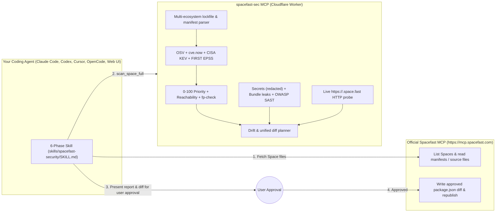

<p align="center">
  <picture>
    <source media="(prefers-color-scheme: dark)" srcset="assets/logo-dark.png">
    
  </picture>
</p>

<h1 align="center">Spacefast Security (<code>spacefast-sec</code>)</h1>

<p align="center"><strong>SecMon × Spacefast: 6-Phase Security &amp; CVE Auditor MCP Server + Plugin for <code>*.space.fast</code> and <code>drop.fast</code></strong></p>

<p align="center">
  <a href="https://github.com/umitaltinozzz/security-monitor"></a>
  
  
  
  
</p>

`spacefast-sec` is a standalone, keyless **Cloudflare Worker Streamable HTTP MCP Server** and **Multi-Agent Security Plugin** (`skills/spacefast-security/SKILL.md`) built to work alongside Automattic's official **Spacefast MCP (`https://mcp.spacefast.com`)** in a single chat session.

> **Companion to [Security Monitor (`secmon`)](https://github.com/umitaltinozzz/security-monitor):**
> `spacefast-sec` brings the deterministic vulnerability matching, `cve.now` + OSV + CISA KEV + FIRST EPSS prioritization, repository-to-production drift detection, and strict **fail-closed (`needs_validation`)** rules from **[umitaltinozzz/security-monitor](https://github.com/umitaltinozzz/security-monitor)** directly to Spacefast (`*.space.fast` and `drop.fast`) deployments.

---

## Install as a Plugin (All AI Tools & Web UI)

Just like [`spacefast/plugins`](https://github.com/spacefast/plugins), this repository includes native plugin manifests (`.claude-plugin`, `.codex-plugin`, `.cursor-plugin`, `.antigravity-plugin`, `.plugin`, `.grok-plugin`, `.kimi-plugin`, `.factory-plugin`, `GEMINI.md`, and `.mcp.json`) so you can install both the **Spacefast MCP + `spacefast-sec` MCP** and the **6-Phase Security Skill** with a single command:

### Claude Code
```bash
claude plugin marketplace add umitaltinozzz/spacefast-sec
claude plugin install spacefast-sec@spacefast-sec
```

### OpenAI Codex
```bash
codex plugin marketplace add umitaltinozzz/spacefast-sec
codex plugin add spacefast-sec@spacefast-sec
```

### Cursor
```bash
npx -y plugins add umitaltinozzz/spacefast-sec -t cursor -y
```

### GitHub Copilot CLI
```bash
copilot plugin install umitaltinozzz/spacefast-sec
```

### Antigravity (`agy`)
```bash
agy plugin install https://github.com/umitaltinozzz/spacefast-sec
```

### Goose
```bash
DISABLE_TELEMETRY=1 npx -y skills@1.5.23 add https://github.com/umitaltinozzz/spacefast-sec/tree/main/skills --agent goose --skill '*' --yes
```

### Claude.ai Web & ChatGPT Web (`chatgpt.com`)
In **Claude.ai** (*Settings → Integrations → Add Remote MCP*) or **ChatGPT** (*Settings → Connectors → Add MCP Server*), add:
- **Spacefast MCP:** `https://mcp.spacefast.com`
- **Spacefast Security MCP:** `https://spacefast-sec-mcp.umiqi.workers.dev/mcp`

(`ALLOWED_ORIGINS` in [`wrangler.toml`](wrangler.toml) pre-authorizes `https://claude.ai` and `https://chatgpt.com`.)

---

## Why `spacefast-sec` exists

When projects are deployed to **Spacefast** (`*.space.fast`) or dragged-and-dropped via **`drop.fast`**:
1. **Static asset exposure:** Dropping a raw project folder without a build filter can expose `/.env`, `/.git/HEAD`, `/package.json`, `/package-lock.json`, or production source maps (`/*.js.map`) directly on the public `https://<name>.space.fast` URL.
2. **Client-bundle secret & fail-open leaks:** Rapidly built apps frequently leak private API keys through `VITE_*` / `NEXT_PUBLIC_*` / `REACT_APP_*` environment prefixes or fall back to hardcoded secrets (`process.env.JWT_SECRET || "default"`).
3. **Unpinned ranges & local-to-Space drift:** A vulnerability fixed in your local workspace may never have been published to the live Space, or the Space may only have a `package.json` without a lockfile.

With `spacefast` MCP + `spacefast-sec` MCP configured together, your coding agent reads the Space's files, runs a deterministic 6-phase audit, shows you a unified `package.json` diff, and—only after your explicit approval—patches and republishes the Space in the same chat.

---

## How it works in a single chat



---

## Synthesized Security Frameworks

`spacefast-sec` combines **4 official open-source security skill frameworks** with the **[Security Monitor (`secmon`)](https://github.com/umitaltinozzz/security-monitor)** engine:

| Framework | What is integrated |
|---|---|
| **[Security Monitor (`secmon`)](https://github.com/umitaltinozzz/security-monitor)** | Multi-ecosystem inventory (`package-lock.json`, `pnpm-lock.yaml`, `yarn.lock`, `package.json`, `requirements.txt`, `Cargo.lock`, `go.mod`), **OSV + [`cve.now`](https://cve.now) + CISA KEV + FIRST EPSS** enrichment, deterministic 0–100 priority scoring, local-vs-Space drift detection, and strict fail-closed verification. |
| **Cloudflare (`cloudflare/security-audit-skill`)** | 6-Phase Audit Discipline, `CoverageLedger` (tracking audited manifests, lockfiles, source files, and blind spots), and evidence-gated 3-bucket verdicts (`confirmed`, `needs_validation`, `rejected`). |
| **Trail of Bits (`trailofbits/skills`)** | `fp-check` false-positive gate (dev-only unimported dependencies are separated into `rejected`; SPA catch-all `200 text/html` responses on `/.env` are never false-flagged), `insecure-defaults` fail-open detector (`process.env.SECRET \|\| "default"`, disabled TLS verification), and unpinned range checks. |
| **Semgrep (`semgrep/skills` — `code-security`)** | OWASP Top 10 SAST rules (`dangerouslySetInnerHTML`, `eval()`, raw SQL template interpolation, shell command interpolation), hardcoded credential detection with mandatory redaction, and `VITE_*` / `NEXT_PUBLIC_*` client-bundle secret leak detection. |
| **Spacefast (`spacefast/plugins`)** | Single-chat remediation workflow with `https://mcp.spacefast.com` (`edit-space`, `fix-deployment`) to apply approved `package.json` diffs and verify builds. |

---

## MCP Tools Exposed (`POST /mcp`)

| Tool | Description |
|---|---|
| **`scan_space_full`** | Runs all 6 phases end-to-end on `{ files, spaceUrl? }` and returns `overallState` (`vulnerable \| needs_validation \| clean`), `coverageLedger`, 3-bucket `dependencyFindings`, `codeAndSecretFindings`, `liveProbe`, `validationReasons`, `dataGaps`, and `remediationPlan`. |
| **`audit_dependencies`** | Parses manifests and lockfiles, queries OSV + `cve.now` + CISA KEV + FIRST EPSS, traces runtime code imports, and computes 0–100 priority scores. |
| **`audit_code_and_secrets`** | Scans source files for hardcoded keys/tokens (always redacted), `VITE_*`/`NEXT_PUBLIC_*` client-bundle secret leaks, Trail of Bits fail-open defaults, Semgrep SAST patterns, and exposed `.env`, `.git`, `.pem`, `.npmrc`, `.sqlite`, and `.js.map` files. |
| **`probe_live_space`** | Probes a live `https://<name>.space.fast` or `*.drop.fast` deployment for downloadable sensitive files (`/.env`, `/.env.local`, `/.git/HEAD`, `/package.json`, `/package-lock.json`, `/*.js.map`) with SPA fallback filtering, and audits HTTP security headers (`Content-Security-Policy`, `Strict-Transport-Security`, `X-Content-Type-Options`, `X-Frame-Options`). |
| **`compare_space_drift`** | Compares local workspace files against deployed Space files to detect `fixed_locally_vulnerable_in_space`, version mismatches, and missing lockfiles on the Space. |
| **`plan_space_remediation`** | Generates non-breaking `package.json` upgrades (including `overrides` / `pnpm.overrides` / `resolutions` for transitive dependencies) and a unified diff with `@@` hunks. |

---

## Fail-Closed Guarantees

Following [Security Monitor's core rule](https://github.com/umitaltinozzz/security-monitor), **missing or unverified data is never marked safe**:

`overallState` is `clean` **only** when every one of these holds; otherwise it returns `needs_validation` with explicit `validationReasons`:
- Every ecosystem with a manifest has a parsed lockfile (`missingLockfileFor` is empty), no lockfile failed to parse (`unparsedLockfiles` is empty), and no unsupported manifest (`pyproject.toml`, `composer.lock`, `bun.lock`, etc.) was supplied without a supported lockfile.
- No unpinned or unresolvable dependency specifier remains.
- OSV and CISA KEV answered completely (`complete: true`).
- If a `spaceUrl` was probed, the Space was reachable and every sensitive-path check was conclusive (HTTP `429`, `5xx`, or timeouts are recorded in `unverifiedPaths` and trigger `needs_validation`).

---

## Self-Hosting / Development

```bash
# 1. Install dependencies
pnpm install

# 2. Run strict TypeScript check & test suite (60 tests)
pnpm typecheck
pnpm test

# 3. Run locally with Wrangler (http://localhost:8787/mcp)
pnpm dev

# 4. Deploy to Cloudflare Workers
pnpm deploy
```

---

## Configuration (`wrangler.toml`, zero API keys)

All upstream vulnerability feeds are public and keyless:

| Variable | Default | Purpose |
|---|---|---|
| `CVE_NOW_URL` | `https://cve.now` | SecMon `cve.now` advisory enrichment (`/api/v1/entries/{cveId}`), cached per isolate for 6 hours. |
| `OSV_BATCH_URL`, `OSV_VULN_URL` | `https://api.osv.dev/v1/...` | OSV batch and vulnerability detail endpoints. |
| `CISA_KEV_URL` | `cisagov/kev-data` mirror + `cisa.gov` fallback | Known Exploited Vulnerabilities catalog, cached per isolate for 6 hours. |
| `FIRST_EPSS_URL` | `https://api.first.org/data/v1/epss` | Exploit Prediction Scoring System (EPSS) scores and percentiles. |
| `PROBE_ALLOWED_SUFFIXES` | `space.fast,drop.fast` | Host suffixes the live probe may target (prevents misuse as an open scanner). |
| `PROBE_ALLOW_CUSTOM_DOMAINS` | `false` | When `"true"`, allows custom domains after verifying via DNS-over-HTTPS (DoH) that A/AAAA records do not resolve to private/loopback IPs. |
| `ALLOWED_ORIGINS` | `"https://claude.ai,https://chatgpt.com"` | Browser origins allowed to call `/mcp` (CLI/desktop MCP clients send no `Origin` header). |
| `RATE_LIMITER` | 30 req / 60 s per IP | Cloudflare Workers Rate Limiting binding. |

---

## Related Projects

- **[Security Monitor (`secmon`)](https://github.com/umitaltinozzz/security-monitor)** — The main local-first desktop app, CLI, read-only Linux SSH agent, and Rust vulnerability engine that powers the `secmon` ecosystem.
- **[cve.now](https://cve.now)** — Curated CVE feed and summaries used by Security Monitor and `spacefast-sec` (CC BY 4.0).
- **[Spacefast Plugins & MCP](https://github.com/spacefast/plugins)** — Official Spacefast MCP server and plugins for creating, editing, and publishing Spaces.

## License

Apache-2.0. See [Security Monitor (`umitaltinozzz/security-monitor`)](https://github.com/umitaltinozzz/security-monitor) for full data source attributions.
